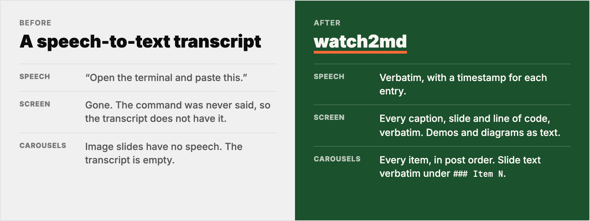

<h1 align="center">watch2md</h1>

<p align="center">
  <strong>Turn short videos into knowledge your AI agent can use: what is said, and what is only on screen.</strong>
</p>

<p align="center">
  
  
  
  
  
</p>

<p align="center">
  
</p>

Short videos teach a lot: a prompt, a command, a framework on a slide, a tool in a demo. Much of it is only on screen. Give your agent the link to a reel, a TikTok, a YouTube video or an Instagram carousel. Your agent runs `watch2md "<url>"` and gets a markdown note with the speech and with all that the video shows: captions, slides, code, UI demos and diagrams. Then your agent puts that knowledge into your skills, playbooks and notes.

A transcript tool hears the speech only. In a reel that says *"paste this"* and shows the command on screen, the transcript has no command. An image carousel has no speech, so a transcript is empty. watch2md sends every item to Gemini, which watches the video and reads each slide.

> **AI agents:** read [`AGENTS.md`](AGENTS.md). It is the complete protocol.

---

## Before and after

<p align="center">
  
</p>

## How it works

<p align="center">
  
</p>

```
Instagram URL ──→ gallery-dl (videos + images) ─┐
other URL ──────→ yt-dlp (≤720p) ───────────────┤  browser cookies if login is needed
                                                ↓
              Gemini Files API ──→ Gemini reads every item, in order ──→ <slug>-<post-id>.md
                                   (fallback: Whisper, speech only)
```

Why gallery-dl for Instagram: yt-dlp cannot download Instagram images. On an image post, the cookie retry then reports "login required", and the real cause is the images. See [GOTCHAS.md](GOTCHAS.md).

## The note

```markdown
---
source: <url>
video_id: <id>
date: <UTC time>
title: "<title>"
items: <N>          # carousels only
mode: video         # or audio
model: <Gemini model>
---

# <title>

## Takeaways
## Timeline         # [mm:ss] SAID / ON SCREEN / SHOWN; ### Item N per carousel item, no timestamps on images
## Shown, not said
```

| Section | What |
|---|---|
| Takeaways | The concrete, reusable points of the video |
| Timeline | Each entry has a `[mm:ss]` timestamp and a label. SAID is the speech, verbatim. ON SCREEN is the text on screen, verbatim. SHOWN is what the video demonstrates: diagrams as structure, interfaces and what changes in them, the tools on screen |
| Shown, not said | The information that is only on screen and not in the speech |

The prompt tells Gemini to write `[illegible]` for text it cannot read, and never to invent speech.

## Who it is for

| You | You do today | watch2md adds |
|---|---|---|
| Build AI skills, prompts and playbooks | You watch a video, then retype the steps by hand | A note your agent turns into a skill or a playbook entry |
| Use an AI agent every day | Your agent cannot open a video link | One command that your agent runs from any folder |
| Keep a knowledge base | You save the post and do not watch it again | A markdown note you can search, quote and reuse, with every slide and every line of code verbatim |

It does not keep the video. The downloads and the Gemini uploads are deleted after each run.

## Install

You need `bash`, `curl`, `jq`, `ffmpeg`, `yt-dlp`, and `gallery-dl` for Instagram.

```sh
brew install jq ffmpeg yt-dlp gallery-dl   # Linux: your package manager, and pip install yt-dlp gallery-dl
git clone https://github.com/4arkin/watch2md.git
ln -s "$PWD/watch2md/watch2md" /opt/homebrew/bin/watch2md   # or /usr/local/bin, any folder always on PATH
```

Get a Gemini API key at https://aistudio.google.com/apikey. On macOS, keep it in the Keychain, where agent shells can read it:

```sh
security add-generic-password -a "$USER" -s watch2md-gemini-api-key -w
```

Elsewhere, export `GEMINI_API_KEY`.

## Use

```sh
watch2md "https://www.instagram.com/reel/<id>/"
watch2md "https://www.instagram.com/p/<id>/"    # carousel: videos, images, or both
watch2md --audio-only "<url>"                   # speech only, through OpenAI Whisper
```

### Let your agent use it

Paste this into `CLAUDE.md`, `AGENTS.md` or `GEMINI.md` in your home or project folder:

```markdown
## Video URLs
Any Instagram or Threads post, reel or carousel (videos, images or both), and any TikTok / YouTube / LinkedIn / X video URL → `watch2md "<url>"` via the shell, from any folder. Never a scraper or the browser.
```

Then send a link to your agent. The full protocol is in [AGENTS.md](AGENTS.md).

## Settings

| Variable | Default | Does |
|---|---|---|
| `GEMINI_API_KEY` | Keychain `watch2md-gemini-api-key` | Video mode. With no key, watch2md uses audio-only mode. |
| `OPENAI_API_KEY` | none | Audio-only mode, and the fallback when video mode fails. |
| `WATCH2MD_OUT` | current folder | Where notes go. |
| `WATCH2MD_BROWSER` | `chrome` | Browser for login cookies (`brave`, `firefox`, `edge`, `safari`). Empty turns the cookie retry off. |
| `WATCH2MD_GEMINI_MODEL` | `gemini-flash-latest` | Gemini model. |

## Cost

An 80-second reel is about 45K input tokens on Gemini Flash, roughly $0.05. An 8-slide image carousel is about 9K. Audio-only mode is about $0.006 per minute.

## FAQ

**Why not a transcript tool?**
A transcript has the speech only. The command in a coding reel, the text on a slide and the numbers in a demo are often on screen and not in the speech. Those go to the "Shown, not said" section.

**Does it work on image carousels?**
Yes. watch2md downloads every Instagram post with gallery-dl, so image slides, video items and mixed carousels all work. Each item gets a `### Item N` block, and the slide text is verbatim.

**Why does macOS ask for a password?**
Instagram needs a login, so watch2md reads your browser's cookies. macOS asks for access to "Chrome Safe Storage". Click **Allow**, not **Always Allow**. watch2md then keeps only that site's cookies in the Keychain, so the prompt comes once per site. On Linux there is no cookie cache.

**What if Gemini fails?**
watch2md falls back to Whisper, which transcribes the speech only. The note then has `mode: audio` and has no on-screen content. Audio-only mode needs `OPENAI_API_KEY`.

**What about long YouTube videos?**
Over 20 minutes, watch2md sends the YouTube link instead of a download, at standard resolution, so the video fits the context window.

**Can it read a full profile?**
No. Collect the reel URLs from the profile's `/reels/` page in a browser, then run them one at a time, with about 20 seconds between runs.

## Test

```sh
bash tests/test.sh
```

The test runs offline. It replaces yt-dlp, gallery-dl, ffmpeg and the Gemini API with stubs, and checks the request and the note for a single video, a reel, and video, mixed and image-only carousels.

## Inside

| Path | What |
|---|---|
| `watch2md` | The script |
| [`AGENTS.md`](AGENTS.md) | The protocol your agent follows, and the snippet for your agent's instructions |
| [`GOTCHAS.md`](GOTCHAS.md) | Carousels, cookies, Gemini, Whisper and agent shells: known traps, and the fix for each |
| `tests/` | `bash tests/test.sh`, offline |

## License

MIT. See [`LICENSE`](LICENSE).
